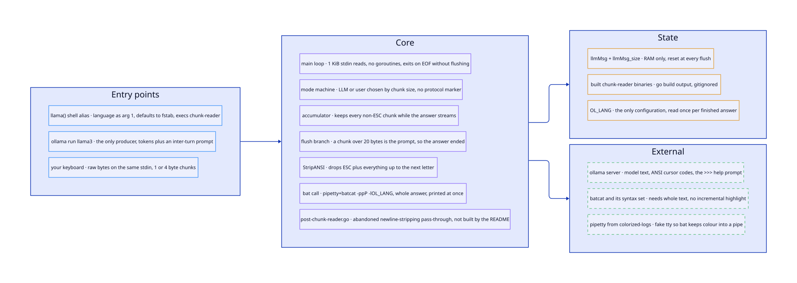

# ollama-syntaxhighlight — how it works

A tiny Go program that sits between `ollama run` and your terminal: it lets the model's answer stream past untouched, then reprints that same answer through `bat` with syntax highlighting once the model has finished.

Read it left to right:

- **It is guessing who is talking, not parsing a protocol.** One pipe carries three things — the model's tokens, ollama's `>>> Send a message` prompt, and your keystrokes — so the loop classifies every read by size alone: chunks up to 20 bytes are model output, anything larger is the prompt, and in user mode a 1-byte or 4-byte chunk is a keypress. Those three numbers are literals in `chunk-reader.go`; there is no framing anywhere.
- **The answer is printed twice on purpose.** It streams through raw so you see it arrive, and when the prompt chunk lands the accumulated copy is ANSI-stripped and handed to `batcat` in one piece. That is the whole design constraint: `bat` needs the complete buffer to highlight, which is exactly why the README's `stdbuf` idea could never have worked.
- **`pipetty` is load-bearing.** `bat` sees a pipe, decides it is not a terminal, and would drop colour; `pipetty` from `colorized-logs` lends it a fake tty. Without it you still get the duplicate text, just plain.
- **The language name is bat's, not the shell's.** `-l` is concatenated with `OL_LANG` verbatim, so `llama C++` asks bat for `-lC++` — bat calls that syntax `cpp`. The `fstab` default exists because it is generic, not because it is right.
- **There is no config file and almost no state.** The only memory is the in-memory answer slice, cleared on every flush; the only setting is the `OL_LANG` environment variable. Two consequences worth knowing: `post-chunk-reader.go` is the abandoned first attempt (it stripped newlines an earlier stage injected) and the README never builds it, and pressing Ctrl-D right after an answer exits on EOF *before* the flush, so that last answer stays unhighlighted.

Diagram source: [`docs/system.d2`](docs/system.d2) · render with [`scripts/render-diagram.sh`](scripts/render-diagram.sh) (writes `docs/system.svg` and `docs/system.png`).
